# Weld Seam Laser Triangulation

An offline laser triangulation system that measures the geometry of circumferential weld seams on cylindrical samples: seam **height**, **depth**, **width**, and the **offset** between the two welded pieces. From these measurements it also reconstructs the sample in 3D.

All samples of this project have a diameter of 30 mm. The length of each piece varies from 15 mm to 60 mm, and the algorithm measures every combination of lengths automatically.

The system was built as a student assistant (HiWi) project at the Institut für Dynamik und Schwingungen, Leibniz Universität Hannover, in support of the project *Ultraschallunterstütztes Laserstrahlschweißen* (ultrasonic-assisted laser beam welding). It runs in the lab, inside a measurement box, on samples that have already been welded.

## Measurement principle

A line laser projects a line across the weld seam while a camera views it at an angle. Any height change on the surface shifts the line sideways in the camera image, so the shape of the line is the profile of the seam. Rotating the sample one full turn gives one profile every 0.5° around the circumference.

<p align="center">
  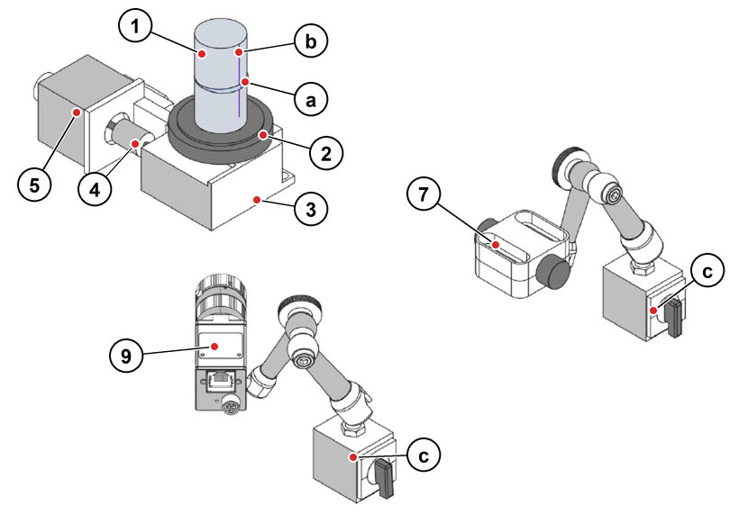
</p>

<div align="center">

*Figure 1: Schematic setup. a: weld seam, b: laser line, c: magnetic stand. The numbers match the component table below. The built system uses 3D-printed mounts on an aluminium profile instead of the magnetic stands.*

</div>

Each pixel `(u, v)` on the laser line defines a viewing ray of the camera. The 3D point is where this ray meets the calibrated laser plane `nᵀX = d`:

$$
X = s\,K^{-1}\begin{bmatrix}u\\v\\1\end{bmatrix},\qquad
s = \frac{d}{n^{T}K^{-1}\begin{bmatrix}u & v & 1\end{bmatrix}^{T}}
$$

`K` is the camera matrix. `K`, `n` and `d` all come from the calibration in Step 0.

## Hardware

<p align="center">
  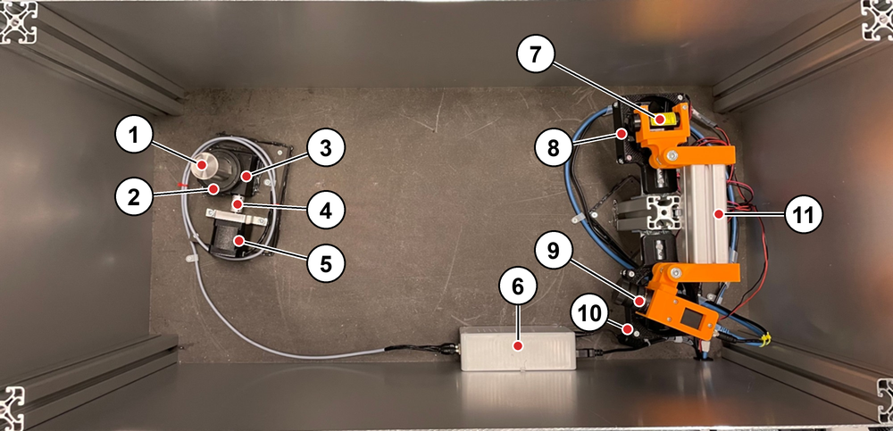
</p>

<div align="center">

*Figure 2: The constructed system inside the measurement box, top view.*

</div>

<div align="center">

| No.&emsp;&emsp; | Component | Type | Function |
| --- | --------- | ---- | -------- |
| 1 | Sample | Two welded cylindrical pieces, diameter 30 mm, length of each piece 15 to 60 mm | Workpiece under test |
| 2 | Adapter | – | Holds the sample on the rotary table |
| 3 | Rotary table | Gear ratio 1:45 | Rotates the sample |
| 4 | Shaft coupling | – | Connects the motor to the rotary table |
| 5 | Stepper motor | Trinamic QSH4218-51-10-049 (1.8°, 1 A, 0.49 Nm) | Drives the rotary table |
| 6 | Control box | Arduino UNO R3 and A4988 driver module | Generates the step signals and tells MATLAB when to take an image |
| 7 | Line laser | PGL-L1 series, 405 nm | Projects the laser line |
| 8 | Fan | 5 V USB fan | Below the line laser |
| 9 | Camera with lens&emsp;&emsp; | Basler ace 2 a2A1920-51gmBAS (mono, GigE) with Basler Lens C23-1618-5M (C-mount)&emsp;&emsp; | Records the laser line |
| 10 | Fan | 5 V USB fan | Below the camera |
| 11 | Aluminium profile&emsp;&emsp; | With 3D-printed adjustable mounts | Carries the laser and camera |

</div>

The line laser emits laser radiation. Follow the laser class and safety information on the module label.

## Software requirements

- MATLAB R2025a (the version the live scripts were saved in)
- Computer Vision Toolbox
- Image Processing Toolbox
- Signal Processing Toolbox
- Image Acquisition Toolbox with the GigE Vision hardware support package
- Basler pylon Viewer, to take the calibration images
- Arduino IDE with the [AccelStepper](https://www.airspayce.com/mikem/arduino/AccelStepper/) library (installed through the Library Manager), to upload the stepper motor control to the Arduino UNO

Open the live scripts in the MATLAB Live Editor and run them from there, because they use the editor to locate the project folder.

## Connecting the camera

The camera connection follows the MathWorks [GigE Vision Image Acquisition Quick Start Guide](https://www.mathworks.com/help/imaq/gige-quick-start-guide.html):

1. Connect the camera directly to a dedicated Gigabit Ethernet adapter on the computer.
2. In the adapter properties, set Jumbo Frame and Receive Buffers to the highest supported values.
3. Set the adapter to obtain its IP address automatically.
4. Turn off the firewall for the camera's network connection only, since it can block the image data.
5. If frames are dropped, adjust `PacketSize` and `PacketDelay` on the `gigecam` object.

`Step1_ImageAcquisition.mlx` then reads the images directly into MATLAB through `gigecam`.

## Workflow

Each step has its own live script. Step 0 is a preparation phase, which is why it is numbered 0. Steps 1 and 2 are the actual measurement and are run for every sample. Step 3 builds the 3D reconstruction from the results of Step 2.

<div align="center">

| Step&emsp;&emsp; | Script | Input | Output |
| ---- | ------ | ----- | ------ |
| 0 | `Step0_Calibration.mlx` | Calibration image pairs | `calibrationParams/cameraParams.mat`, `calibrationParams/triangulationParams.mat` |
| 1 | `Step1_ImageAcquisition.mlx`&emsp;&emsp; | Sample in the rotary table&emsp;&emsp; | `Sample_<mark>_T<top>B<bottom>.mat` with 720 images |
| 2 | `Step2_SeamEvaluation.mlx`&emsp;&emsp; | Recordings and calibration&emsp;&emsp; | Results per sample and an Excel summary |
| 3 | `Step3_3DReconstruction.mlx`&emsp;&emsp; | Results of Step 2 and calibration&emsp;&emsp; | 3D surface and plots per sample |

</div>

### Step 0: Calibration

This preparation step determines the camera parameters and the position of the laser plane. It rebuilds the workflow of the MATLAB camera calibration tools as a script, and it supports a single (mono) camera only.

**When to run it.** Running Step 0 once is enough as long as the positions of the camera, laser and rotary table stay unchanged. Repeat it only if one of them has been moved.

**Calibration board.** The checkerboard was generated with the [calib.io pattern generator](https://calib.io/pages/camera-calibration-pattern-generator) (15 × 18 squares, 6 mm square size, 115 × 105 mm page). It is printed on 100 g/m² paper, glued to a flat acrylic board and kept flat under pressure while it sets. Measure the printed square size, because it scales all results, and enter it as `squareSize`.

**Taking the calibration images.** The images themselves are not part of this repository, so here is how to take them:

1. Mount the camera, lens and laser in their measurement position. Lock the focus and aperture of the lens. Nothing may move after this point, during the calibration or the later measurements.
2. In the pylon Viewer, use the same image region as in Step 1 (1920 × 1200 px, `OffsetX = 8`, `OffsetY = 8`).
3. Hold the board in the area where the sample will be, so that it fills at least 20 % of the image and is fully visible.
4. Take two images of this pose without moving the board in between, and save them as 8-bit BMP in `calibrationImages/`:
   - `imgCam**.bmp` without the laser line, for the camera calibration
   - `imgLas**.bmp` with the laser line, for the laser plane
5. Adjust the exposure time separately for the two image types. The laser line must not be saturated in the `imgLas` images.
6. Change the position and tilt of the board and repeat from step 4. Vary the distance, tilt and image position, including the edges of the image, until the poses cover the measuring range. 15 to 30 poses are recommended.

`**` is a running number (01, 02, ...), and the two images of a pose must have the same number.

<p align="center">
  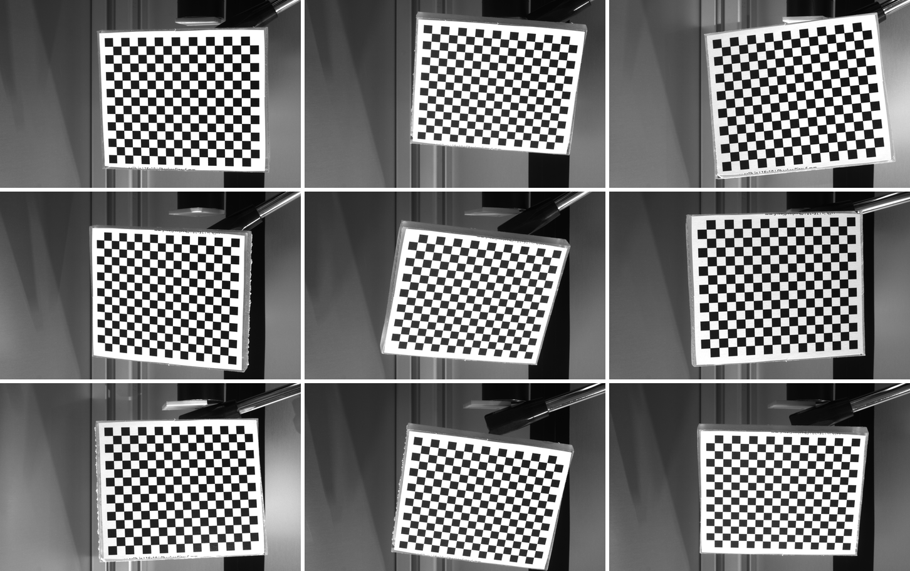
  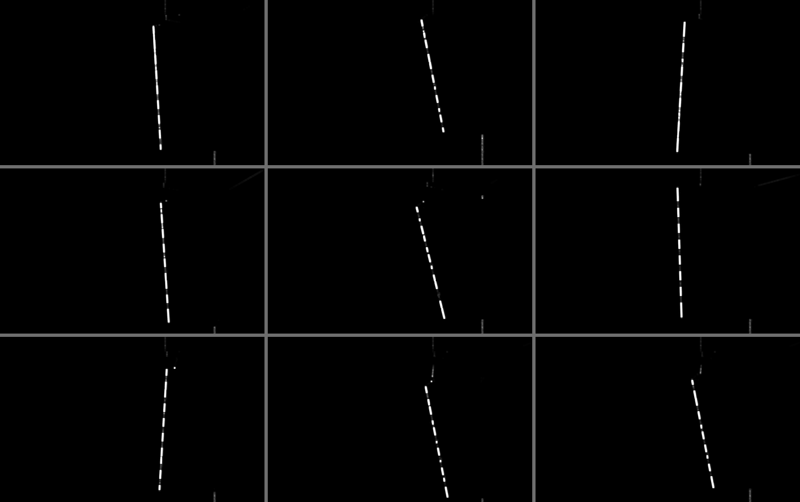
</p>

<div align="center">

*Figure 3: Nine of the 21 calibration poses used here. Left: `imgCam` images. Right: the matching `imgLas` images in the same order. The laser line appears dashed because the black squares reflect little light. It is thickened and brightened here so that it stays visible at this size.*

</div>

**Processing.**

1. Camera calibration with Zhang's method: checkerboard detection, then estimation of focal length, principal point and distortion. Images with a mean reprojection error above 0.5 px are removed step by step.
2. Laser plane: the laser line in each `imgLas` image is detected with Steger's method on the undistorted image. Its viewing rays are intersected with the board plane of that pose, which gives 3D points in the camera coordinate system. A plane is fitted through the points of all poses.

<p align="center">
  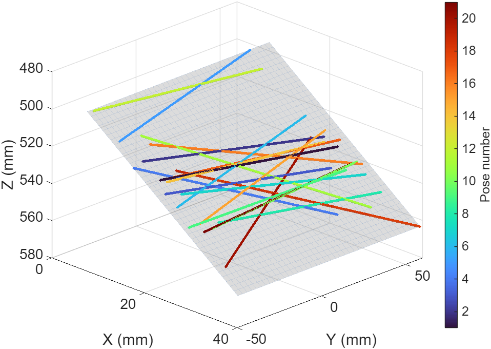
  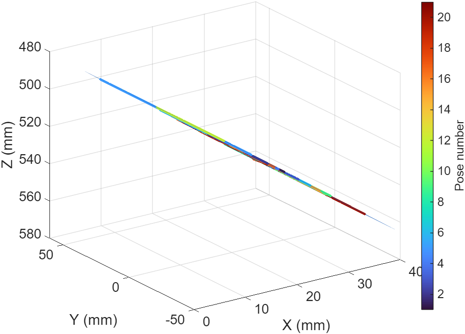
</p>

<div align="center">

*Figure 4: Calibrated laser plane in the camera coordinate system. Each coloured line is the laser line of one board pose, 20 poses and 16,000 points in total, with the fitted plane in grey. Left: oblique view. Right: the same data seen along the plane, where all the lines merge into one thin line.*

</div>

**Calibration in this repository.**

<div align="center">

| Quantity | Value |
| -------- | ----- |
| Image size | 1920 × 1200 px |
| Image pairs | 21 for the camera, 20 for the laser plane |
| Mean reprojection error | 0.18 px |
| Laser plane fit RMS | 0.033 mm |
| Angle between laser plane and optical axis&emsp;&emsp;&emsp;&emsp; | 25.4° |
| Distance from the camera to the sample&emsp;&emsp;&emsp;&emsp; | approx. 540 mm |
| Scale at the sample, along the sample axis&emsp;&emsp;&emsp;&emsp; | approx. 0.11 mm/px |
| Scale at the sample, across the laser line&emsp;&emsp;&emsp;&emsp; | approx. 0.30 mm/px |

</div>

### Step 1: Image acquisition

The stepper motor rotates the sample through one revolution while the camera records the laser line. Images are taken only during the constant-speed phase of the motion. In the example recordings one revolution took about 45 s.

The motor runs in 1/16 microstepping, and the rotary table has a gear ratio of 1:45, so the angular step per image follows from these values:

<div align="center">

| Quantity | Value |
| -------- | ----- |
| Microsteps per motor revolution&emsp;&emsp;&emsp;&emsp; | 200 full steps × 16 = 3200 |
| Microsteps per sample revolution&emsp;&emsp;&emsp;&emsp; | 3200 × 45 = 144,000 |
| Microsteps between two images | 200 |
| Sample rotation between two images&emsp;&emsp;&emsp;&emsp; | 0.5° |
| Images per sample | 720 |

</div>

Before starting, set the COM port in the script (default `COM3`, 115200 baud) and enter the sample mark and the lengths of the two pieces. These form the file name, for example `Sample_2133_T30B30.mat`, and Step 2 reads the lengths from it. An existing file is never overwritten, and if the acquisition aborts, the images taken so far are saved as `_incomplete.mat`.

The Arduino triggers each image: at every image position it sends a signal to MATLAB over the serial port, and MATLAB takes the image immediately. MATLAB and the Arduino exchange these messages:

<div align="center">

| Direction | Message | Meaning |
| --------- | ------- | ------- |
| MATLAB → Arduino&emsp;&emsp;&emsp;&emsp; | `MotorStart` | Start the motor |
| Arduino → MATLAB&emsp;&emsp;&emsp;&emsp; | `GET READY` | Preparation before the image sequence |
| Arduino → MATLAB&emsp;&emsp;&emsp;&emsp; | `IMAGE SHOOT START`&emsp;&emsp;&emsp;&emsp; | Constant speed reached |
| Arduino → MATLAB&emsp;&emsp;&emsp;&emsp; | `1` to `720` | Take image number *n* now |
| Arduino → MATLAB&emsp;&emsp;&emsp;&emsp; | `IMAGE SHOOT STOP`&emsp;&emsp;&emsp;&emsp; | Revolution finished, motor brakes |

</div>

The Arduino also sends `MOTOR START` before `GET READY` and `MOTOR STOP` at the end of the braking ramp. MATLAB ignores both.

#### Stepper motor control

The sketch [`stepperMotorControl/stepperMotorControl.ino`](stepperMotorControl/stepperMotorControl.ino) runs on the Arduino UNO and drives the motor through the A4988 driver with the AccelStepper library. It waits for `MotorStart` on the serial port and then turns the rotary table with a trapezoidal velocity profile. Images are only taken while the speed is constant, so the ramps do not change the angle between two images.

<p align="center">
  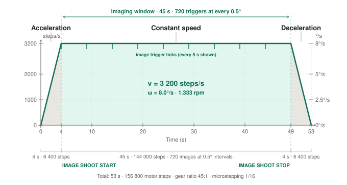
</p>

<div align="center">

*Figure 5: Velocity profile of one acquisition run. Left axis: motor speed, right axis: speed of the rotary table.*

</div>

<div align="center">

| Phase | Duration | Motor steps | Table rotation | Serial messages |
| ----- | -------- | ----------- | -------------- | --------------- |
| Acceleration | 4 s | 6,400 | 16° | `MOTOR START`, `GET READY` |
| Constant speed&emsp;&emsp; | 45 s | 144,000 | 360° | `IMAGE SHOOT START`, `1` to `720`, `IMAGE SHOOT STOP`&emsp;&emsp; |
| Deceleration | 4 s | 6,400 | 16° | `MOTOR STOP` |
| Total | 53 s | 156,800&emsp;&emsp; | 392°&emsp;&emsp; | |

</div>

At the constant speed of 3200 steps/s the motor turns once per second and the table at 8°/s (1.33 rpm). The acceleration is 3200 steps/s ÷ 4 s = 800 steps/s². An image is triggered every 200 steps, which is every 62.5 ms, so the camera and MATLAB have to keep up with 16 images per second.

**Image triggers.** During the constant-speed phase `AccelStepper::runSpeed()` keeps the speed fixed. The STEP signal on pin 10 is also connected to pin 2, which is an interrupt pin. An interrupt routine counts the rising edges, and on every 200th step the main loop sends the image number to MATLAB. Counting starts at the end of the acceleration and stops at the start of the deceleration, so the 720 images cover exactly one revolution.

**Wiring.**

<div align="center">

| Arduino pin | Connected to | Function |
| ----------- | ------------ | -------- |
| 13 | A4988 `ENABLE` | `LOW` enables the driver outputs |
| 12 | A4988 `RESET` | `HIGH` for normal operation |
| 11 | A4988 `SLEEP` | `HIGH` wakes the driver |
| 10 | A4988 `STEP` | Step pulses |
| 9 | A4988 `DIR` | Direction of rotation, set to `LOW` in the sketch |
| 2 | Pin 10 (jumper wire)&emsp;&emsp; | Reads back the step pulses for counting |

</div>

The sketch assumes 1/16 microstepping, which is set on the driver with `MS1`, `MS2` and `MS3` all `HIGH`. After each run the driver is put to sleep and its outputs are switched off, so the motor holds no torque between runs.

**Uploading.** Open the sketch in the Arduino IDE, install AccelStepper, select the board *Arduino UNO* and upload. Close the Serial Monitor before running Step 1, because only one program can open the COM port at a time.

**Changing the profile.** The ramp time and speed are set by `accelTime` and `maxSpeed`; the step counts of all three phases follow from them. The image spacing is set by `stepRatio` (steps per image). If you change it, also change `SampleImageNum` in Step 1 so that `stepRatio × SampleImageNum = 144,000`.

**Start position.** The table has no reference sensor, so image 1 is not at a fixed angle on the sample. Each run ends 392° after it started, which is 32° past the start position.

### Step 2: Seam evaluation

Each recording is evaluated in the following order:

1. Remove the lens distortion from all images.
2. Find the region of interest and the seam area from the images of the sample itself. The nominal lengths only limit the search range.
3. Detect the laser line in every image by its intensity: the brightest position per row, refined to sub-pixel accuracy with a Gaussian fit. This gives the seam profile. The search stays in a band around the mean line position, so spatter and background reflections are ignored.
4. Remove outliers with a Hampel filter and smooth the profile with a Savitzky-Golay filter.
5. Fit a baseline to each of the two sample pieces, then find the seam start and end points from the deviation from these baselines.
6. Find the highest and lowest points of the seam relative to the baseline, and the contact point of the two pieces.
7. Convert all points from pixels to 3D coordinates on the laser plane, using the calibration parameters.
8. Calculate the seam geometry in millimetres as 3D distances between these points.

<div align="center">

| Result&emsp;&emsp;&emsp;&emsp; | Definition |
| ------ | ---------- |
| Height&emsp;&emsp;&emsp;&emsp; | Distance from the highest seam point to the baseline |
| Depth | Distance from the lowest seam point to the baseline, given as a negative value |
| Width | Distance between the seam start and end points |
| Offset&emsp;&emsp;&emsp;&emsp; | Distance between the two baselines at the contact point of the pieces |

</div>

An image can have both a height and a depth, for example with an S-shaped seam. Values that cannot be determined are set to `NaN`.

Figure 6 shows this detection on eight real images. Each panel is a crop of the ROI around the seam, with the adapter side at the top. A raised seam shifts the laser line to the right, and a dip shifts it to the left.


<p align="center">
  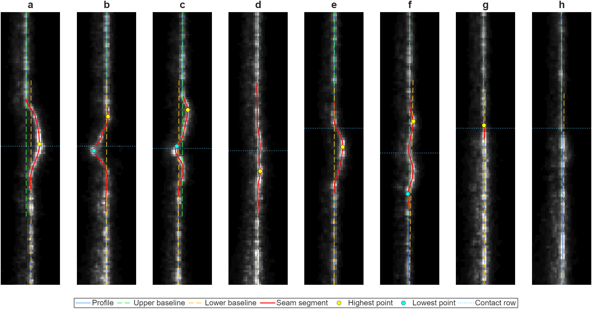
</p>

<div align="center">

*Figure 6: Seam detection in eight ROI images. The images are brightened for display. Height, depth, width and offset are the values evaluated for each image, in mm.*

</div>

<div align="center">

| Panel&emsp;&emsp; | Sample&emsp;&emsp; | Position&emsp;&emsp; | Height&emsp;&emsp; | Depth&emsp;&emsp; | Width&emsp;&emsp; | Offset&emsp;&emsp; | Case |
| ----- | ------ | -------- | ------ | ----- | ----- | ------ | ---- |
| a | 2133 | 48.0° | 1.98 | – | 4.59 | 0.73 | Highest seam, with offset |
| b | 2133 | 176.5° | 0.21 | −1.87&emsp;&emsp; | 5.18 | 0.01 | Deep dip |
| c | 2133 | 229.0° | 0.79 | −0.83&emsp;&emsp; | 4.98 | 0.55 | S-shaped seam |
| d | 2141 | 104.0° | 0.41 | – | 6.53 | 0.01 | Wide, flat seam |
| e | 2121 | 159.0° | 1.25 | – | 3.83 | 0.01 | Clear bump, no offset |
| f | 2141 | 267.5° | 0.58 | −0.48&emsp;&emsp; | 5.52 | 0.35 | S-shaped seam, with offset |
| g | 2121 | 314.5° | 0.09 | – | 0.68 | 0.21 | Close to the detection limit |
| h | 2121 | 217.0° | – | – | – | 0.38 | No seam detected (`NaN`) |

</div>

As a calibration check, the script compares the measured 3D length from the adapter to the free end with the nominal length (top + bottom − insertion depth). It warns if they differ by more than 3 %.

**Mirroring.** Recordings are taken with `ReverseX = True`, and `opt.MirrorX` must state whether they are mirrored relative to the calibration images. The calibration in this repository was taken without mirroring, so it needs `opt.MirrorX = true`. If you recalibrate with `ReverseX = True`, set `opt.MirrorX = false`.

**Output.** Each sample gets a folder in the chosen results folder, with a summary of all samples next to them:

<div align="center">

| File | Content |
| ---- | ------- |
| `SeamEvaluation.mat` | Results, points and profiles per image |
| `LaserStripData.mat` | Cropped laser line images |
| `SeamHeight.jpg`, `SeamWidth.jpg`, `SampleOffset.jpg`&emsp;&emsp;&emsp;&emsp; | Plots over the circumference |
| `Summary_<sample>.xlsx` | Key values of this sample |
| `Summary_<date>.xlsx` | Key values of all samples |

</div>

### Step 3: 3D reconstruction

Each image gives one full profile of the sample and one known rotation angle, so the 720 profiles of a sample can be placed around the rotation axis to form its surface. This uses the complete profiles saved in `SeamEvaluation.mat`, not only the height and width values. No further images are needed. Select either the results folder of Step 2, then one or more samples in the list (all are preselected), or one sample folder directly.

1. Fit the baselines of both pieces per image as in Step 2 and repair line errors outside the seam.
2. Convert all profiles to 3D coordinates on the laser plane.
3. Find the rotation axis in the laser plane. Its direction comes from the line position averaged over one revolution, where the runout cancels out. Its position comes from the sample diameter, which is set with `opt.Diameter` (30 mm).
4. Place each profile at its rotation angle around the axis.
5. Align the surface to the axis of the piece in the adapter, which removes the runout and tilt of the mounting.
6. Calculate the height of every row relative to the baseline of its own piece.

The result is shown in two ways:

- **Cylinder:** the surface as it is on the real sample, to scale, with the seam height as colour.
- **Unfolded plane:** the cylinder cut open and laid flat, as seen from the outside, so the whole seam is visible at once. The upper map shows the whole sample, the lower map a close-up of the seam.

**Offset of the two pieces.** Each piece is compared with its own baseline, so an offset does not appear as a sunken surface: the surface outside the seam stays flat in both views. The offset stays in the 3D coordinates and is listed in the title of the unfolded plot. The offset values themselves come from Step 2.

**Line errors.** Outside the seam the surface is smooth, so a line more than 1 px (approx. 0.30 mm) below the baseline is treated as a line error, for example a reflection, and interpolated along the profile. Spatter stays visible because it lies above the surface. Repaired positions are saved in `Recon.LineError`.

The colour scales are the same for all samples, so the plots can be compared directly.

**Sense of rotation.** The images do not show which way the sample turns, so it is set with `opt.RotationDirection` (seen from the free end: `1` counterclockwise, `-1` clockwise). The value `1` is provisional and still has to be confirmed on the device. A wrong value mirrors the sample, and all dimensions stay correct.

**Output.** Each sample folder of Step 2 receives these files:

<div align="center">

| File | Content |
| ---- | ------- |
| `Reconstruction3D.mat` | Surface coordinates, height, deviation from the cylinder with the offset (`Recon.Deviation`), offset, repaired positions, unfolded coordinates, runout and tilt |
| `Seam3D_Cylinder.jpg`&emsp;&emsp;&emsp;&emsp; | Sample as a cylinder, seen from two opposite sides |
| `Seam3D_Unfolded.jpg`&emsp;&emsp;&emsp;&emsp; | Cylinder unfolded into a plane |

</div>

## Example results

Three samples are included, each with 30 mm top and bottom pieces (nominal length 58 mm from adapter to free end). Height and width are given as median, with the 5th to 95th percentile in brackets.

<div align="center">

| Sample&emsp;&emsp; | Images with seam&emsp;&emsp; | Height (mm) | Width (mm) | Offset, median (mm)&emsp;&emsp; | Length deviation |
| ------ | ---------------- | ----------- | ---------- | ------------------- | ---------------- |
| [2121](evaluations/Sample_2121_T30B30) | 569 / 720 | 0.79 (0.16 to 1.03)&emsp;&emsp; | 2.72 (1.24 to 3.40)&emsp;&emsp; | 0.12 | −0.41 % |
| [2133](evaluations/Sample_2133_T30B30) | 720 / 720 | 0.63 (0.25 to 1.58)&emsp;&emsp; | 4.24 (2.87 to 5.50)&emsp;&emsp; | 0.21 | −0.41 % |
| [2141](evaluations/Sample_2141_T30B30) | 718 / 720 | 0.67 (0.33 to 0.99)&emsp;&emsp; | 4.07 (2.71 to 5.18)&emsp;&emsp; | 0.11 | −0.22 % |

</div>

<p align="center">
  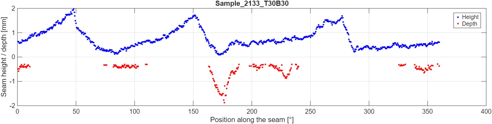
</p>


<div align="center">

*Figure 7: Seam height (blue) and depth (red) of sample 2133 over one revolution.*

</div>

<p align="center">
  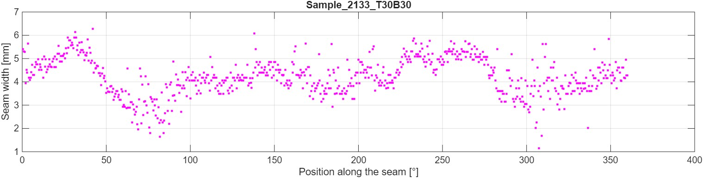
</p>


<div align="center">

*Figure 8: Seam width of sample 2133 over one revolution.*

</div>

<p align="center">
  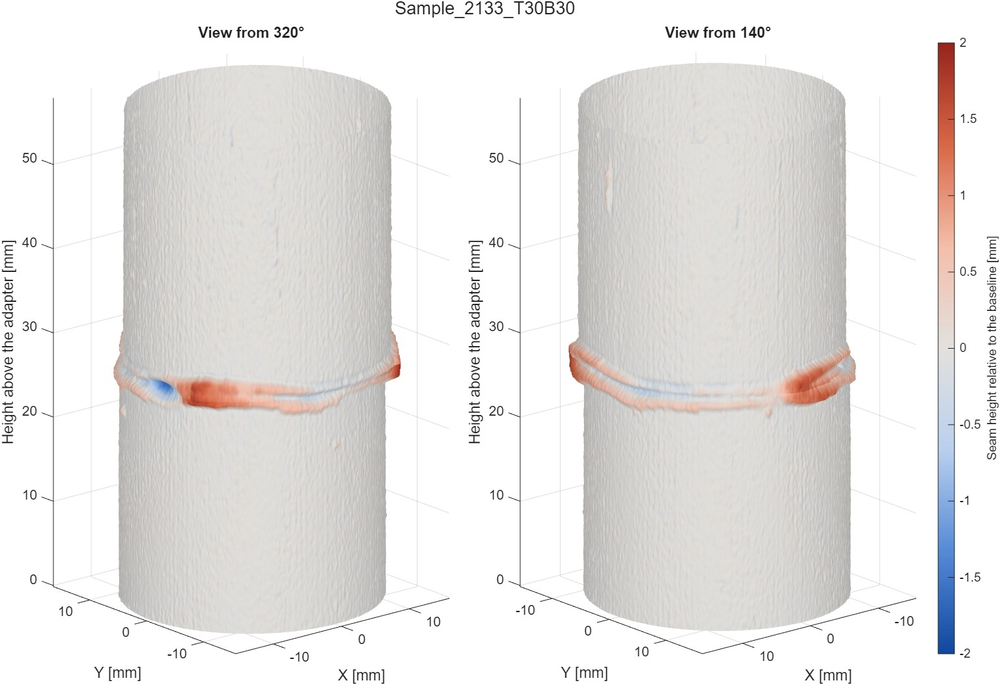
</p>

<div align="center">

*Figure 9: 3D reconstruction of sample 2133 as a cylinder. Red is above the baseline, blue is below it.*

</div>

The offset of the two pieces can be seen in Figure 9 as a small step in the outline at the seam. It is clear in sample 2133 because its offset is the largest of the three samples: up to 0.73 mm, against 0.38 mm in samples 2121 and 2141. Figure 10 and the table below give its values over the circumference.

<p align="center">
  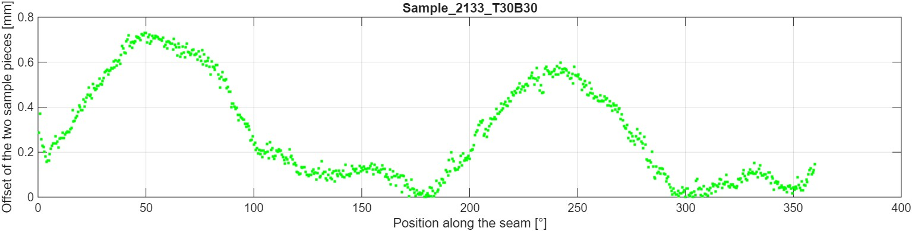
</p>

<div align="center">

*Figure 10: Offset of the two pieces of sample 2133 over one revolution.*

</div>

<div align="center">

| Position&emsp;&emsp; | Offset (mm)&emsp;&emsp; | Free piece relative to the piece in the adapter |
| -------- | ----------- | ----------------------------------------------- |
| 0° | 0.19 | Outwards |
| 30° | 0.53 | Outwards |
| 60° | 0.68 | Outwards |
| 90° | 0.43 | Outwards |
| 120° | 0.13 | Outwards |
| 150° | 0.12 | Outwards |
| 180° | 0.02 | Flush |
| 210° | 0.33 | Inwards |
| 240° | 0.56 | Inwards |
| 270° | 0.36 | Inwards |
| 300° | 0.02 | Flush |
| 330° | 0.11 | Outwards |

</div>

The values are means over 5°. Step 2 gives the size of the offset only, and the direction comes from comparing the two pieces in `Recon.Deviation`.

The two peaks in Figure 10 are not two separate defects. They are one sideways shift of the free piece, seen from opposite sides: near 50° the free piece stands out by up to 0.73 mm, and near 242° it lies inwards by about 0.6 mm. Between them the pieces are flush, at about 176° and 300°, so the offset depends strongly on the position. It exceeds 0.5 mm on 24 % of the circumference and stays below 0.05 mm on 13 %, and the median of 0.21 mm understates the largest value by a factor of about 3.5.

Three effects add up to this course: a sideways shift of about 0.47 mm, the three lobes of about 0.17 mm described below, and a constant 0.07 mm. Together they give the 0.7 mm of the highest peak, and they also explain why the two peaks differ in height and why they are not exactly 180° apart.

<p align="center">
  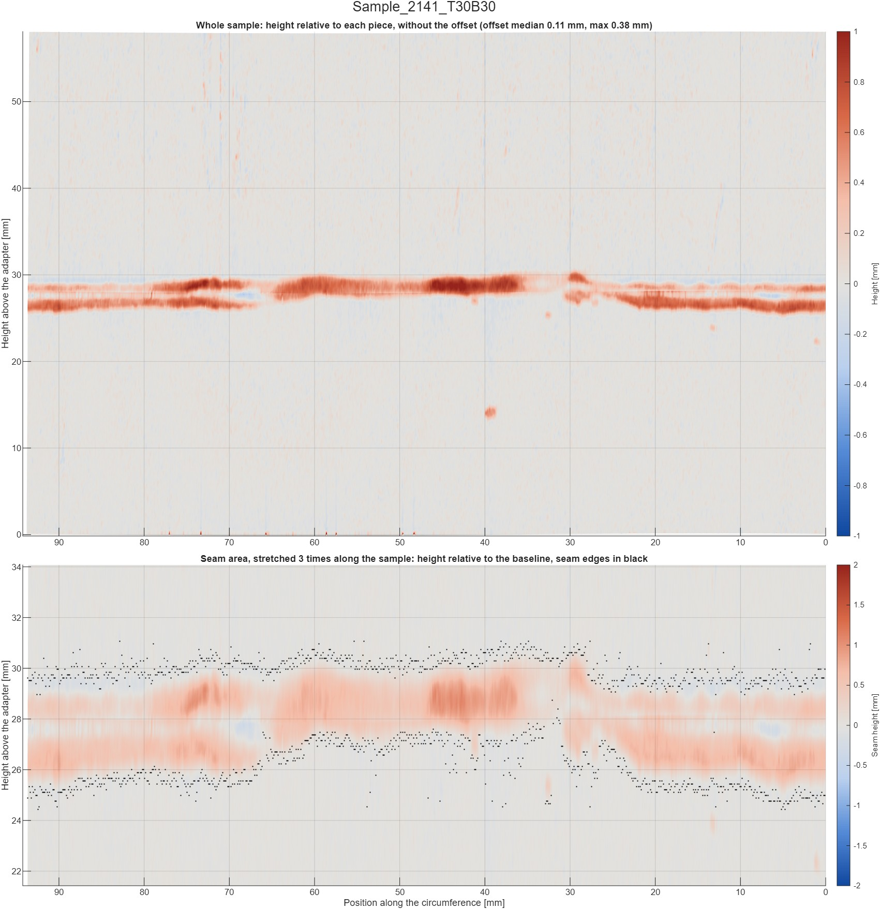
</p>

<div align="center">

*Figure 11: Sample 2141 unfolded into a plane. Top: whole sample, height relative to each piece. Bottom: seam area. The black points are the seam start and end detected in Step 2, one point each per image, and the distance between them is the seam width. They lie slightly outside the coloured area because Step 2 places an edge where the line just starts to leave the baseline.*

</div>

The highest point of each reconstructed profile agrees with the seam height of Step 2, with a median difference below 0.001 mm and a maximum of 0.13 mm. In the 59 images with a repaired line error the baseline is no longer tilted by that error, so individual values differ more, by up to 0.18 mm in height and 0.39 mm in depth. Line errors affect 0.05 % to 0.31 % of the surface. In all three samples the sample is mounted with a runout of about 0.49 mm at the adapter and a tilt of 0.34° to 0.40° relative to the rotation axis. The reconstruction removes both. `Recon.Deviation` also shows a three-lobed shape on the free piece: about 0.17 mm in amplitude, constant along the piece, with lobes 120° apart. The piece in the adapter does not have it. These lobes contribute to the offset of Step 2.

## Accuracy and limitations

**Accuracy.** The measurement accuracy has not been verified, because no standard reference tool was available. The indirect indicators are good: the calibration errors above are small, and the measured sample length deviates by at most 0.41 % from nominal. The expected error is therefore small compared with seam dimensions in the millimetre range, but this is an estimate and not a validated uncertainty. The length check also confirms the scale only along the sample axis, not in the height direction, and it assumes that the nominal lengths are exact.

**Known limitations.**

- **Low seams.** A seam that deviates from the baseline by less than about 0.3 px (approx. 0.09 mm) cannot be separated from noise, and the image returns `NaN`. This is limited by the pixel resolution. In sample 2121, 151 of 720 images have no seam result.
- **Shallow dips.** A dip is only reported if it is more than 1 px (approx. 0.30 mm) below the baseline.
- **Complex seam shapes.** With irregular seams the detected points may not represent the real geometry, so the results can be inaccurate.
- **Fixed setup.** Any movement of the camera, lens, laser or rotary table, or any change to the camera image settings, requires a new calibration.
- **3D reconstruction.** Profiles lie 0.5° apart, or 0.13 mm along the circumference, while the resolution along the sample is approx. 0.11 mm, so the surface between two profiles is interpolated. The absolute radius comes from the nominal diameter and is not measured, and the laser plane is assumed to contain the rotation axis. A real scratch deeper than approx. 0.30 mm outside the seam would be treated as a line error.

## Repository structure

```text
├── Step0_Calibration.mlx        Camera and laser plane calibration
├── Step1_ImageAcquisition.mlx   Image acquisition during rotation
├── Step2_SeamEvaluation.mlx     Seam geometry evaluation
├── Step3_3DReconstruction.mlx   3D reconstruction as a cylinder and an unfolded plane
├── functions/                   MATLAB functions used by the live scripts
├── calibrationParams/           Calibration results
├── recordings/                  Example recordings of three samples
├── evaluations/                 Evaluation results of the example recordings
├── stepperMotorControl/         Arduino sketch for the stepper motor
└── docs/images/                 Figures for this README
```

`calibrationImages/` and `references/` are kept locally and are excluded by `.gitignore`. The public versions of the reference documents are linked below.

## References

**Datasheets and guides**

<div align="center">

| Component | Document |
| --------- | -------- |
| Camera | [Basler ace 2 a2A1920-51gmBAS](https://www.baslerweb.com/en/shop/a2a1920-51gmbas/) |
| Lens | Basler Lens C23-1618-5M, succeeded by the [C23-1620-5M](https://www.baslerweb.com/en/shop/basler-lens-c23-1620-5m-f16mm/) |
| Line laser | [CNI PGL-L1 series datasheet](https://www.cnilaser.com/PDF/PGL-L1.pdf) |
| Stepper motor | [Analog Devices (Trinamic) QSH4218](https://www.analog.com/en/products/qsh4218.html) |
| Stepper driver | [Allegro A4988 datasheet](https://www.allegromicro.com/-/media/files/datasheets/a4988-datasheet.pdf) (driver chip) |
| Arduino UNO R3 | [Product page](https://docs.arduino.cc/hardware/uno-rev3/), [datasheet](https://docs.arduino.cc/resources/datasheets/A000066-datasheet.pdf), [pinout](https://docs.arduino.cc/resources/pinouts/A000066-full-pinout.pdf), [schematics](https://docs.arduino.cc/resources/schematics/A000066-schematics.pdf) |
| GigE Vision setup&emsp;&emsp;&emsp;&emsp; | [MathWorks GigE Vision Image Acquisition Quick Start Guide](https://www.mathworks.com/help/imaq/gige-quick-start-guide.html) |
| Calibration board&emsp;&emsp;&emsp;&emsp; | [calib.io pattern generator](https://calib.io/pages/camera-calibration-pattern-generator) |

</div>

**Publications**

- Z. Zhang, "A flexible new technique for camera calibration", *IEEE Transactions on Pattern Analysis and Machine Intelligence*, vol. 22, no. 11, 2000.
- C. Steger, "An unbiased detector of curvilinear structures", *IEEE Transactions on Pattern Analysis and Machine Intelligence*, vol. 20, no. 2, 1998.

## Third-party code

`functions/hessian2D.m` and `functions/eigImageHessian.m` are based on code by Dirk-Jan Kroon (2009), under the BSD licence in `functions/LICENSE_Kroon.txt`.
